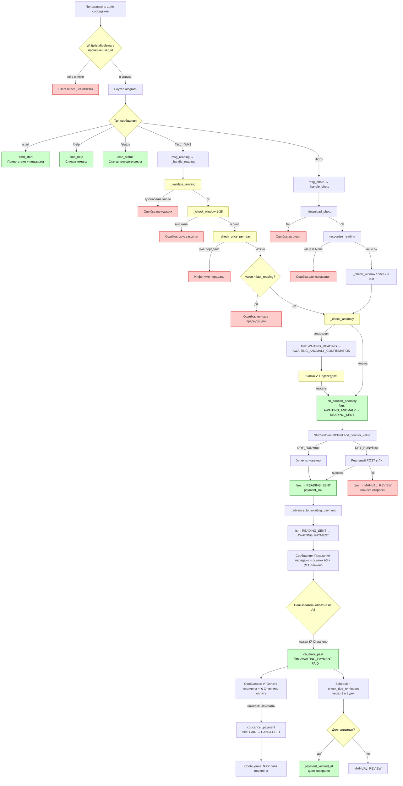

# Жизненный цикл биллинга в Telegram-боте (Anapa Water Agent v1.1)

Документ описывает реальный путь пользователя: от проверки WhitelistMiddleware и ввода показаний (текст / фото) до оплаты по ссылке А3, перевода в `PAID` и сверки долга. Все статусы, хендлеры, файлы и развилки взяты из текущего кода.

---

## 1. Happy Path — пошаговый сценарий

| Шаг | Экран / Компонент | Действие пользователя | Логика в коде / API запрос |
|-----|-------------------|------------------------|----------------------------|
| 1 | `WhitelistMiddleware` (`middleware.py:12`) | Любое сообщение / команда | Проверка `settings.is_user_allowed(user_id)` — если нет — **silent reject** (нет ответа). |
| 2 | `/start` (`handlers.py:77`) | Нажимает /start | `cmd_start` → приветствие + подсказка «Отправь целое показание, например: 100». |
| 3 | Ввод показания текстом (`msg_reading`, `handlers.py:445`) | Отправляет число, напр. `100` | `_validate_reading` → `_check_window` (день 1–25) → `_check_once_per_day` (нет цикла в статусах `READING_SENT/AWAITING_PAYMENT/PAID/ACCRUAL_PENDING`) → `value < last_reading` (не меньше предыдущего) → `_check_anomaly` (медиана × `ANOMALY_FACTOR`). |
| 4А | Аномалия (нет истории / расход > порог) | — | `_check_anomaly` возвращает `True` → `fsm.transition(WAITING_READING → AWAITING_ANOMALY_CONFIRMATION)` → бот показывает кнопку **«✅ Подтвердить»** (`callback_data="confirm:100"`). |
| 4Б | Нормальный расход | — | Переход сразу к шагу 6. |
| 5 | Callback `confirm:*` (`cb_confirm_anomaly`, `handlers.py:396`) | Нажимает «✅ Подтвердить» | `fsm.transition(AWAITING_ANOMALY_CONFIRMATION → READING_SENT)` с `reading_source=text|photo`, `event_type="reading.sent"`. |
| 6 | Отправка в ЛК (`_handle_reading`, `handlers.py:253`) | — | `StubVodokanalClient.add_counter_value(value)` (DRY_RUN=true → мгновенный успех; DRY_RUN=false → реальный POST). |
| 7 | Переход в `READING_SENT` | — | `fsm.transition` с `payment_link=build_payment_link(ACCOUNT_ID)` → бот отвечает «✅ Показание 100 передано. Расход: 100 м³.» |
| 8 | `_advance_to_awaiting_payment` (`handlers.py:163`) | — | `fsm.transition(READING_SENT → AWAITING_PAYMENT, event_type="accrual.done")`. |
| 9 | Оплата — ссылка А3 | Переходит по ссылке, оплачивает на сайте А3 | `_send_payment_prompt` (`handlers.py:159`) → сообщение с суммой долга + кнопка **«💳 Оплачено»** (`mark_paid`). |
| 10 | Callback `mark_paid` (`cb_mark_paid`, `handlers.py:429`) | Нажимает «💳 Оплачено» | `fsm.transition(AWAITING_PAYMENT → PAID, event_type="payment.claimed")` → сообщение «✅ Оплата отмечена. Будем проверять.» + кнопка **«❌ Отменить оплату»**. |
| 11 | Проверка оплаты (scheduler, `jobs.py`) | — | Через 1 и 3 дня: `check_due_reminders` читает долг из ЛК; если долг снизился → `payment_verified_at` ставится, цикл завершён; если нет — `MANUAL_REVIEW`. |
| 12 | (Опционально) Отмена оплаты | Нажимает «❌ Отменить оплату» | `cb_cancel_payment` (`handlers.py:449`) → `fsm.transition(PAID → CANCELLED)` → «❌ Оплата отменена. Цикл остановлен.». |

---

## 2. Развилки и Edge Cases (сценарии ошибок)

| Ситуация | Где проверяется | Результат / переход |
|----------|-----------------|---------------------|
| Пользователь не в whitelist | `WhitelistMiddleware.__call__` (`middleware.py:24`) | Silent reject — никакого ответа. |
| Дробное показание (`100.5` / `100,5`) | `_validate_reading` (`handlers.py:42`) | Ошибка: «Дробное показание отклонено. Счётчик принимает только целые.» |
| Вне окна приёма (день < 1 или > 25) | `_check_window` (`handlers.py:54`) | Ошибка: «Приём закрыт. Окно передачи: 1–25 число.» |
| Уже передано сегодня | `_check_once_per_day` (`handlers.py:60`) | Инфо: «ℹ️ Показание уже передано сегодня: N.» |
| Новое показание < предыдущего | `value < last_reading` (`handlers.py:200`, `343`) | Ошибка: «❌ Показание меньше предыдущего (N).» |
| Аномальный расход (нет истории / расход > медиана × factor) | `_check_anomaly` (`handlers.py:112`) | Переход в `AWAITING_ANOMALY_CONFIRMATION`, требуется подтверждение кнопкой. |
| Vision: фото не загрузилось | `_download_photo` (`handlers.py:129`) | Ошибка: «❌ Не удалось загрузить фото. Попробуйте ещё раз.» |
| Vision: значение не распознано (`value is None`) | `recognize_reading` (`vision.py:121`) | Ошибка: «❌ Не удалось распознать показание на фото…» |
| Vision: низкая уверенность (`confidence < CONFIDENCE_MIN`) | `is_confident` (`vision.py:146`) | В текущем коде не блокирует, но можно расширить. |
| Ошибка отправки в ЛК (`add_counter_value` → `success=False`) | `_handle_reading` (`handlers.py:263`) | `fsm.transition(→ MANUAL_REVIEW, event_type="send_failed")` + сообщение об ошибке. |
| Ошибка перехода FSM (недопустимый статус) | `CycleFSM.transition` (`fsm.py:131`) | Возвращает `None`, хендлер отвечает «❌ Не удалось начать/обновить цикл.» |
| Пользователь отменил оплату после PAID | `cb_cancel_payment` (`handlers.py:449`) | `PAID → CANCELLED`, кнопки убираются. |
| Испчерпаны повторы сверки начислений (6 дней) | `jobs.check_due_reminders` (`jobs.py`) | Переход в `MANUAL_REVIEW`. |

---

## 3. Визуальная схема — Mermaid.js Flowchart

---

## 4. Ссылки на код

| Компонент | Файл | Ключевые функции/классы |
|-----------|------|--------------------------|
| Whitelist | `src/home_bills_agent/bot/middleware.py` | `WhitelistMiddleware` |
| Команды | `src/home_bills_agent/bot/handlers.py` | `cmd_start`, `cmd_help`, `cmd_status` |
| Текстовое показание | `handlers.py` | `msg_reading`, `_handle_reading`, `_validate_reading`, `_check_window`, `_check_once_per_day`, `_check_anomaly` |
| Фото | `handlers.py` | `msg_photo`, `_handle_photo`, `_download_photo` |
| Vision | `src/home_bills_agent/assistant/vision.py` | `recognize_reading`, `is_confident`, `_recognize_anthropic`, `_recognize_openrouter` |
| FSM | `src/home_bills_agent/storage/fsm.py` | `CycleFSM`, `CycleStatus`, `ALLOWED_TRANSITIONS` |
| Оплата | `handlers.py` | `_send_payment_prompt`, `cb_mark_paid`, `cb_cancel_payment`, `_payment_keyboard`, `_cancel_keyboard` |
| Планировщик | `src/home_bills_agent/scheduler/jobs.py` | `check_due_reminders` |
| Конфиг | `src/home_bills_agent/config.py` | `Settings`, `is_user_allowed` |
| Клиент ЛК | `src/home_bills_agent/providers/anapa_vodokanal/client.py` | `StubVodokanalClient`, `HttpxVodokanalClient` |